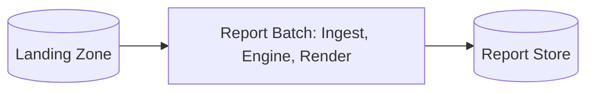
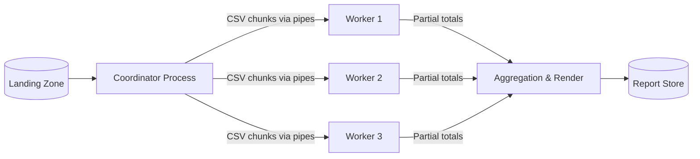
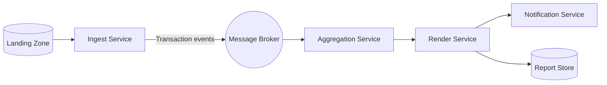

# ATAM-Style Evaluation: Release 1 Architecture

## Business Drivers
- **Morning Delivery SLA:** Consolidated and branch-level reports for month $M$ must be produced and verified on the morning of day 2 of month $M+1$ (by 06:00).
- **Retail Chain Expansion:** Angkor Mart plans to expand beyond its initial three branches (PNH, REP, BTB) into additional provinces, increasing transaction volume linearly.
- **Audit & Financial Accuracy:** Financial records must strictly adhere to Cambodian retail accounting standards using exact `BigDecimal` scale-2 (`HALF_UP`) monetary calculations without double precision drift.
- **Lean Operational Budget:** A small team (2 developers) must build, operate, maintain, and test the reporting pipeline without dedicated 24/7 DevOps or cloud infrastructure teams.

---

## Candidates

### Candidate A: Modular Monolith Batch (One JVM)
A single Java 25 process running on an 8-core server. Memory-efficient streaming pipelines pass typed domain records (`model`) between decoupled packages (`ingest`, `engine`, `render`) via direct in-process method invocation.

---

### Candidate B: Process Pipeline (Coordinator & OS Worker Processes)
A master coordinator process orchestrates multiple worker processes (child JVMs or native workers) connected via local operating system pipes (`stdin`/`stdout`) or Unix domain sockets. Each worker parses and computes partial aggregations on a slice of daily files, streaming compact aggregated totals back to the coordinator.

---

### Candidate C: Event-Driven Microservices (Broker-Connected Services)
Independent microservices deployed across containers and connected by a distributed message broker (e.g., Apache Kafka or RabbitMQ). The Ingest Service reads POS files, publishes transaction events to topics, the Aggregation Service consumes and updates state, and the Report/Notification Services render and dispatch outputs.

---

## Scenario Analysis

| Scenario & Driver | Candidate A: Modular Monolith | Candidate B: Process Pipeline | Candidate C: Event Microservices |
|:---|:---|:---|:---|
| **QA-1 (Performance)** 3 M rows $\le 60\text{ s}$ | **++** In-process streaming with zero network/serialization overhead completes in $\approx 4.9\text{ s}$. | **+** Parallel worker processes achieve $\approx 7.3\text{ s}$; minor inter-process pipe overhead. | **−** High serialization and broker transit latency ($60\text{ s}$ for unbatched messages); requires batching to meet SLA. |
| **QA-2 (Scalability)** +33% volume increase | **+** Easily scales vertically on 8-to-16 core hardware without architectural changes. | **++** Scales by spinning up additional worker processes across available cores or worker nodes. | **++** Elastically scales horizontally by adding consumer container replicas to partitioned message topics. |
| **QA-3 (Availability)** Late branch file arrival | **+** Straightforward batch re-run with idempotent overwrites handles late files. | **+** Coordinator can re-dispatch only the missing branch file to an idle worker process. | **++** Asynchronous broker queues delayed transactions automatically without blocking the pipeline. |
| **QA-4 (Modifiability)** New export format $\le 2\text{ days}$ | **++** Strategy pattern (`ReportRenderer`) enables adding a format in $\le 1$ day in a single package. | **+** Renderers isolated in output stage, but output schema must remain coordinated with workers. | **0** Modifying event contracts or schemas requires coordinated multi-service schema management. |
| **QA-5 (Security)** Tenant branch access control | **+** Single security perimeter; in-process role checks guard report outputs cleanly. | **+** IPC boundaries contained within local host permissions; no external exposure. | **−** Distributed attack surface; requires TLS, mTLS, broker ACLs, and service-to-service authentication. |
| **QA-6 (Testability)** In-memory suite $\le 30\text{ s}$ | **++** 100% testable in-memory with JUnit 6 in $< 5\text{ s}$; no external infrastructure required. | **+** Unit tests are fast, but integration tests require managing child process lifecycles. | **−** Integration tests require Testcontainers, embedded broker instances, and async await assertions. |
| **Cost & Team Skills** | **++** Fits a 2-developer team perfectly; standard Java/Maven build with zero ops overhead. | **+** Moderate complexity; requires managing process supervision and IPC protocols. | **−−** Very high cost; requires distributed tracing, broker clustering, Kubernetes, and monitoring. |

---

## QA-1 Performance Estimates

### Baseline Assumptions
1. **Total Monthly Volume:** $3,000,000$ CSV rows.
2. **Single-Core Parsing & Validation Cost:** $5\ \mu\text{s}$ per row ($\approx 15.0\text{ s}$ sequential CPU work).
3. **Sequential Aggregation Merge:** $2.0\text{ s}$ (in-memory hash map consolidation).
4. **Sequential Report Rendering & File I/O:** $1.0\text{ s}$.
5. **Hardware:** Standard 8-core CPU server ($N = 8$).

### Candidate A: Modular Monolith (1 JVM, 8 Worker Threads)
- **Parallel Fraction ($p$):** Parsing is parallelizable across threads:
  $$p = \frac{15\text{ s}}{15\text{ s} + 2\text{ s} + 1\text{ s}} = \frac{15}{18} \approx 0.833$$
- **Amdahl's Law Theoretical Speedup:**
  $$S(N) = \frac{1}{(1 - p) + \frac{p}{N}} = \frac{1}{0.167 + \frac{0.833}{8}} = \frac{1}{0.167 + 0.104} = \frac{1}{0.271} \approx 3.69\times$$
- **Estimated Wall-Clock Time:**
  $$T_A = \frac{15\text{ s}}{8} + 2.0\text{ s} + 1.0\text{ s} = 1.88\text{ s} + 3.0\text{ s} \approx \mathbf{4.9\text{ s}} \quad (\ll 60\text{ s SLA})$$

### Candidate B: Process Pipeline (4 Child JVMs + Coordinator)
- **Parallel Parsing ($N = 4$):** $\frac{15\text{ s}}{4} = 3.75\text{ s}$.
- **Process Startup Overhead:** Parallel JVM startup takes $\approx 0.5\text{ s}$.
- **Pipe IPC & Merge:** Workers stream aggregated summaries (~few KB), transfer time $< 0.05\text{ s}$.
- **Sequential Work:** $2.0\text{ s}$ merge $+ 1.0\text{ s}$ render $= 3.0\text{ s}$.
- **Estimated Wall-Clock Time:**
  $$T_B = 0.5\text{ s} + 3.75\text{ s} + 2.0\text{ s} + 1.0\text{ s} \approx \mathbf{7.3\text{ s}} \quad (\ll 60\text{ s SLA})$$

### Candidate C: Event-Driven Microservices
- **Broker Throughput:** $50,000\text{ messages/second}$ sustained.
- **Case 1 (Naive 1 row per event):**
  - Transit time alone: $\frac{3,000,000\text{ msgs}}{50,000\text{ msgs/s}} = 60.0\text{ s}$.
  - Network hop, JSON serialization/deserialization ($2\ \mu\text{s/msg} = 6.0\text{ s}$), and merge:
    $$T_{C,\text{naive}} \ge 60.0\text{ s} + 6.0\text{ s} + 3.0\text{ s} \approx \mathbf{69.0\text{ s}} \quad (\text{FAILS QA-1})$$
- **Case 2 (Batched events: 1,000 rows per batch message):**
  - Message count: $\frac{3,000,000}{1,000} = 3,000\text{ batch messages}$.
  - Broker transit time: $\frac{3,000}{50,000} = 0.06\text{ s}$.
  - Parallel processing across worker instances ($N = 8$) + merge:
    $$T_{C,\text{batched}} \approx 0.06\text{ s} + \frac{15\text{ s}}{8} + 3.0\text{ s} \approx \mathbf{5.0\text{ s}} \quad (\text{Meets QA-1})$$

---

## Sensitivity Points

- **S1 (Parser Thread Concurrency in Candidate A):** Affects **QA-1 (Performance)**. Thread count directly determines the parallel scaling factor in Amdahl's Law. Increasing threads up to the physical core count ($N=8$) scales speedup from $1.0\times$ to $3.69\times$; setting threads beyond 8 yields diminishing returns due to CPU cache contention.
- **S2 (Event Batch Size in Candidate C):** Affects **QA-1 (Performance)** by three orders of magnitude. Shifting from 1 row/msg to 1,000 rows/msg reduces broker transit time from $60.0\text{ s}$ down to $0.06\text{ s}$, converting a failure into an acceptable result.
- **S3 (Renderer Interface Decoupling in Candidate A):** Affects **QA-4 (Modifiability)**. Utilizing the Strategy pattern (`ReportRenderer`) restricts the addition of an export format to $\le 2$ source files without modifying parser or engine logic.

---

## Trade-off Points

- **T1 (Asynchronous Broker Buffering vs. Operational Complexity & Latency):**  
  Introducing an external message broker (Candidate C) enhances **QA-3 (Availability)** by naturally buffering late files and providing fault-tolerant queuing. However, this directly trades off against **QA-1 (Performance)** (adding network hops and serialization latency), increases **Cost/Skills** by demanding broker cluster operations, and enlarges the **QA-5 (Security)** attack surface across distributed endpoints.
- **T2 (Process Isolation vs. Hardware Resource Overhead):**  
  Partitioning tasks into separate OS processes (Candidate B) prevents worker crash propagation (**Fault Isolation** and **QA-2 Scalability**), but trades off higher memory footprint (multiple JVM runtimes) and process initialization latency ($\approx 0.5\text{ s}$) compared to in-process threading (Candidate A).

---

## Risks, Non-Risks, and Risk Themes

### Risks
- **R1 (Operational Overwhelm - Candidate C):** Operating a distributed message broker and container orchestration requires specialized DevOps knowledge that exceeds the bandwidth of a 2-developer team, risking delivery delays.
- **R2 (Single Host Hardware Failure - Candidate A):** Running a single monolith process binds execution to one physical server. If the server experiences hardware failure on the morning of day 2, report delivery is halted until the host recovers.

### Non-Risks
- **NR1 (Monetary Calculation Inconsistency):** Strict utilization of immutable `BigDecimal` scale-2 (`RoundingMode.HALF_UP`) guarantees bit-identical financial results across all architectural candidates, eliminating floating-point drift risk.
- **NR2 (Batch Processing Window Capacity for Candidate A):** With an estimated runtime of $\approx 4.9\text{ s}$ on 3 million rows against a $60\text{ s}$ requirement ($>12\times$ headroom), volume surges or branch additions will not endanger the 06:00 AM delivery SLA.

### Risk Theme: Operational Simplicity vs. Premature Distribution
Directly linked to the business driver of delivering a reliable reporting system on a tight timeline with a small engineering team. Adopting distributed microservices or brokers prematurely introduces failure modes (network partitions, serialization errors, distributed configuration drift) that far outweigh the benefits needed for a 3-million-row monthly batch.

---

## Recommendation

**Confirm ADR-0001 (Modular Monolith Batch Architecture).**

The quantitative and qualitative ATAM evaluation decisively validates that **Candidate A** is the optimal architecture for Release 1:
1. **Performance:** Delivers an estimated runtime of $\approx 4.9\text{ s}$, beating the 60-second SLA by more than $12\times$.
2. **Simplicity & Velocity:** Minimizes development effort and operational footprint, maximizing team focus on domain logic and test coverage (**QA-6**).
3. **Evolutionary Path:** Should transaction volume expand by $>10\times$ (exceeding 30 branches or 30 million rows), the system can cleanly transition to **Candidate B (Process Pipeline)** or **Candidate C (Event-Driven Services)** without rewriting core domain models.
