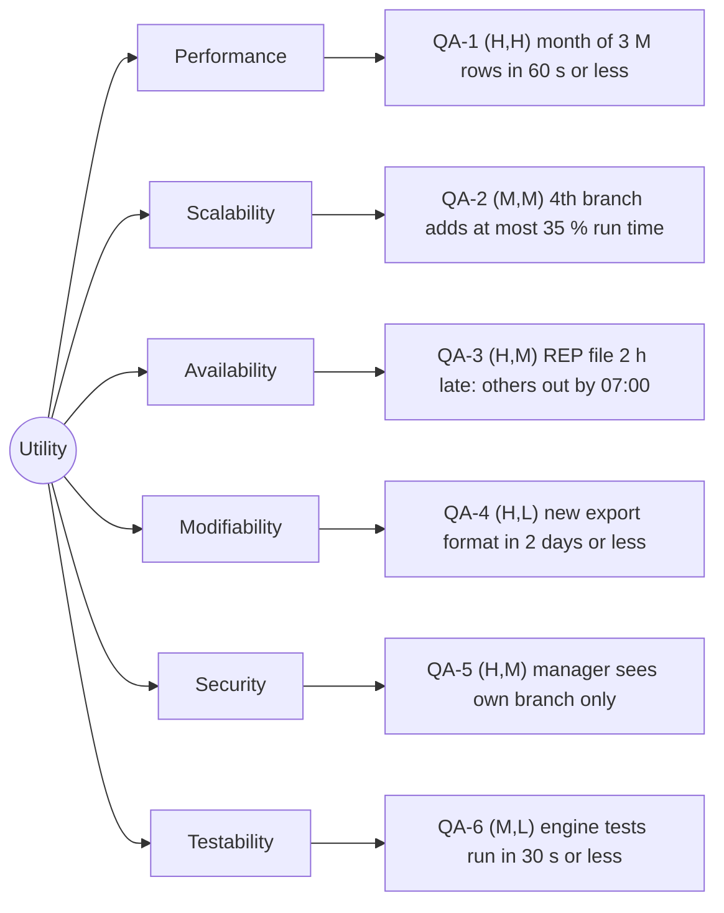

# Quality-attribute scenarios: Angkor Mart monthly sales report

## Stakeholders
- **Head-office analyst:** Needs consolidated monthly reports across all branches and individual branch breakdowns (revenue, discounts, baskets, categories, top products, payment methods, anomalies) to analyze chain-wide sales trends.
- **Branch manager (PNH, REP, BTB):** Needs store-level visibility into daily and monthly performance to manage local inventory and sales; must only access their own branch's data.
- **Finance director:** Requires high-level financial reconciliation and timely notification (via email) when monthly reports are finalized and verified.
- **Operations person (System operator):** Schedules and monitors monthly automated ingestion runs, resolves pipeline failures, and manages late data delivery from branch POS systems.
- **Development team:** Responsible for building, maintaining, testing, and extending the reporting system (e.g., introducing new report formats and scaling to new branch locations).

---

## Scenarios

| ID | Attribute | Source | Stimulus | Artifact | Environment | Response | Response measure | Rank |
|:---|:---|:---|:---|:---|:---|:---|:---|:---:|
| **QA-1** | Performance | Automated Scheduler, 06:00 on day 2 of month M+1 | Trigger monthly aggregation for ~3,000,000 transactions across all 3 branches | Report engine | Normal production, 8-core server, SSD, all input CSV files available | Parses records, calculates summaries using `BigDecimal`, detects anomalies, writes output files, and triggers completion event | $\le$ 60 seconds wall-clock time (median of 5 consecutive benchmark runs after 2 warm-up runs) | **(H, H)** |
| **QA-2** | Scalability | Business Expansion Team / Retail Ops | Addition of a 4th retail branch (~1,000,000 additional transactions/month, ~33% volume increase) | Ingest and aggregation pipeline | Normal production on existing 8-core server hardware | Ingests and processes all 4 branches without code modifications or OutOfMemory errors | Execution time increases by $\le$ 35% compared to the 3-branch baseline over 5 benchmark runs | **(M, M)** |
| **QA-3** | Availability | Branch Internet Service Provider / POS network | Siem Reap (REP) internet link fails, causing daily CSV files to arrive 2 hours late (08:00 instead of 06:00) | Batch ingestion and reporting coordinator | Degraded operating environment (missing branch data at scheduled run time) | Generates partial report for available branches (PNH, BTB) with explicit missing data flags, and automatically regenerates full consolidated report upon late file arrival | Partial reports available by 06:05 (100% of available branches); complete consolidated report generated in $\le$ 120 seconds after late file ingestion | **(H, M)** |
| **QA-4** | Modifiability | Software Developer | Request to add a new report export format (e.g., Markdown or JSON summary) | Report renderer module | Standard development workstation, existing test suite | Developer implements the `ReportRenderer` interface and registers the new strategy without changing core engine code | Implemented, integrated, and passing unit tests in $\le$ 2 person-days of effort, modifying $\le$ 2 existing files | **(H, L)** |
| **QA-5** | Security | Branch Manager (e.g., Siem Reap) | Authenticated manager attempts to access sales figures or reports of another branch (e.g., Phnom Penh) | Web / API Access Controller | Normal operational web portal session | System verifies branch tenancy, denies unauthorized data access, logs the audit event, and returns only the authorized branch view | 0% data leakage across 100% of automated security test cases; HTTP 403 Forbidden returned within $\le$ 200 ms | **(H, M)** |
| **QA-6** | Testability | Developer / Continuous Integration (CI) server | Execution of full regression and calculation test suite | Core calculation engine and ingestion test suites | Headless CI server or local terminal via `mvn test` | Executes unit tests verifying revenue, discount, basket, and anomaly computations in-memory without live external services | Full test suite executes in $\le$ 30 seconds, achieving $\ge$ 85% branch coverage on `engine` and `model` packages measured by JaCoCo | **(M, L)** |

---

## Rank Justifications
- **QA-1 (H, H):** High importance because head office strictly mandates reports by morning of day 2; High difficulty because processing 3,000,000 rows with exact `BigDecimal` rounding requires memory-efficient streaming and thread concurrency.
- **QA-2 (M, M):** Medium importance because physical store expansion happens occasionally (quarterly/annually); Medium difficulty because the pipeline must be structured to avoid partition bottlenecks or scaling cliffs.
- **QA-3 (H, M):** High importance because remote internet connections in provincial branches are known to fail intermittently; Medium difficulty because the system must support partial aggregation and idempotency/re-run capabilities.
- **QA-4 (H, L):** High importance because business stakeholders frequently request new output views (PDF, Excel, Web); Low difficulty because applying the Strategy pattern decouples rendering from business calculations.
- **QA-5 (H, M):** High importance because branch sales figures are commercially confidential and competitive between stores; Medium difficulty because role-based multi-tenant data filtering must be enforced consistently across all access layers.
- **QA-6 (M, L):** Medium importance because high automated test velocity prevents regressions during ongoing lab refactorings; Low difficulty because domain logic can be kept pure and decoupled from filesystem I/O.

---

## Assumptions
- **A1:** The production host machine is provisioned with at least 8 CPU cores, 16 GB RAM, and local SSD storage.
- **A2:** Monthly volume for 3 branches totals approximately 3,000,000 records (~33,000 rows/day per branch).
- **A3:** POS systems export CSV files in UTF-8 format with standard headers; product names do not contain commas.
- **A4:** Money computations must strictly follow `quantity * unit_price - discount` using `BigDecimal` with scale 2 and `RoundingMode.HALF_UP`.
- **A5:** Branch managers authenticate using corporate credentials linked to a specific branch identifier (`PNH`, `REP`, or `BTB`).

---

## Utility tree

---

## Architectural drivers
The architectural drivers are the scenarios that combine high business importance with substantial architectural difficulty:
1. **QA-1 (Performance - H, H):** Demands memory-efficient streaming, parallel CSV ingestion, and optimized `BigDecimal` accumulation.
2. **QA-3 (Availability - H, M):** Dictates resilient batch scheduling, partial report generation, and idempotent pipeline re-runs.
3. **QA-5 (Security - H, M):** Requires strict tenant-aware filtering and authorization barriers across reporting endpoints.
